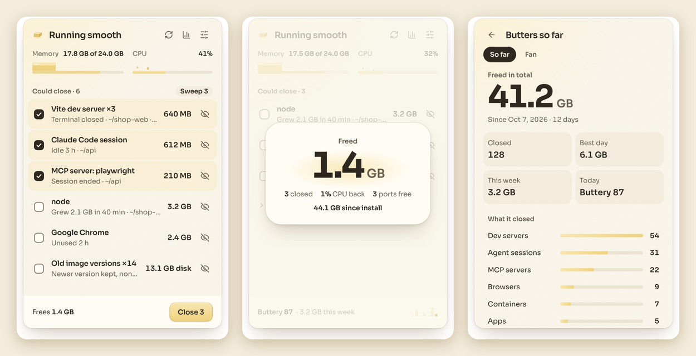

<pre align="center">
▀█████████▄  ███    █▄      ███         ███        ▄████████    ▄████████    ▄████████
  ███    ███ ███    ███ ▀█████████▄ ▀█████████▄   ███    ███   ███    ███   ███    ███
  ███    ███ ███    ███    ▀███▀▀██    ▀███▀▀██   ███    █▀    ███    ███   ███    █▀&nbsp;
 ▄███▄▄▄██▀  ███    ███     ███   ▀     ███   ▀  ▄███▄▄▄      ▄███▄▄▄▄██▀   ███&nbsp;&nbsp;&nbsp;&nbsp;&nbsp;&nbsp;&nbsp;
▀▀███▀▀▀██▄  ███    ███     ███         ███     ▀▀███▀▀▀     ▀▀███▀▀▀▀▀   ▀███████████
  ███    ██▄ ███    ███     ███         ███       ███    █▄  ▀███████████          ███
  ███    ███ ███    ███     ███         ███       ███    ███   ███    ███    ▄█    ███
▄█████████▀  ████████▀     ▄████▀      ▄████▀     ██████████   ███    ███  ▄████████▀&nbsp;
                                                               ███    ███&nbsp;&nbsp;&nbsp;&nbsp;&nbsp;&nbsp;&nbsp;&nbsp;&nbsp;&nbsp;&nbsp;&nbsp;&nbsp;
</pre>

<p align="center">
  
</p>

<p align="center">
  <strong>Your Mac, buttery smooth again. No restart required.</strong>
</p>

<p align="center">
  <a href="https://github.com/KenKaiii/butters/releases/latest"></a>
  <a href="https://github.com/KenKaiii/butters/stargazers"></a>
  <a href="LICENSE"></a>
  <a href="https://youtube.com/@kenkaidoesai"></a>
  <a href="https://skool.com/kenkai"></a>
</p>

Butters lives in your menu bar and keeps a busy dev machine running smooth. A day of coding agents, dev servers and MCP servers leaves a pile of leftovers behind: servers whose terminal is long gone, idle agent sessions, Docker containers nobody touched all week. Butters finds them, tells you what each one is holding, and closes the ones you pick. Nothing closes until you say so.

## Why Butters

**Built for people who run a lot of agents.** Generic cleaners see "node" and "python". Butters knows what they actually are.

- **Leftovers:** dev servers and MCP servers still running after their terminal or session closed.
- **Idle agent sessions:** Claude Code, Codex, GG Coder, Gemini CLI, Aider, OpenCode, Cursor Agent and more, measured by how long they've actually been quiet.
- **Docker:** containers with no activity for days, Docker's own VM memory, old image versions and build cache taking up disk.
- **Leaks:** anything whose memory keeps climbing, like "Grew 2.1 GB in 40 min".
- **The fan:** what's actually been working the CPU over the last half hour, not just right now.

**It never closes what you're using.** The app in front, anything you used in the last 15 minutes, work running inside the app you're in, Butters itself and whatever started it, the system and other users are all protected. Apps get the same polite Quit as their own menu, so they can ask to save. Force close only appears if that fails, and asks first.

**It barely uses anything itself.** About 20 MB of memory and 0% CPU sitting in the menu bar. The panel only exists while it's open.

## What you get

- **One list of what you could close:** each with what it's holding and why it's there. Leftovers are pre-ticked, anything you might still want isn't.
- **Sweep:** one button for the end of the day. Leftovers, idle agents and idle containers in one go. You confirm first.
- **Live meters:** memory as a melting stick of butter, CPU as a sizzling pan. They update every 2 seconds.
- **Lifetime stats:** everything Butters has freed since you installed it, your best day, and what it closed most.
- **Gentle alerts:** a notification when memory is low, the machine is running hot, the CPU stays maxed out, or something starts leaking. At most once every 30 minutes each.
- **⌥⌘B from anywhere:** opens Butters. Change it or turn it off in Settings.
- **Butter all the way down:** rows melt when they close, sounds are soft and in sync, and the panel melts away when you click off it. Turn sounds off any time.
- **Updates itself:** checks GitHub every 6 hours and installs when you click. Every update is signed.

## Get started

1. Install Butters:

   **macOS:** [Download the latest release](https://github.com/KenKaiii/butters/releases/latest), open the `.dmg` and drag Butters into Applications. Apple Silicon and Intel builds, signed and notarized.

   **Windows:** [Download the latest release](https://github.com/KenKaiii/butters/releases/latest) and run the `-setup.exe`.

2. Click the butter pat in your menu bar (or press ⌥⌘B), tick what you want gone, and hit **Close**.

The only permission it asks for is notifications, for alerts. One click turns them on.

## Try it safely

`Butters Playground` is a separate test app that starts seven throwaway processes (dev servers, an agent session, an MCP server, a busy build and a leaking process) and can only see those. Close them as often as you like, then hit **Reset**. Your real apps are invisible to it.

## Build it yourself

With Rust, Node.js, pnpm and the [Tauri prerequisites](https://v2.tauri.app/start/prerequisites/) installed:

```bash
git clone https://github.com/KenKaiii/butters.git
cd butters
pnpm install
pnpm tauri dev          # run it
pnpm playground         # build Butters Playground
```

Tests: `cd src-tauri && cargo test` for the rules and safety checks, `pnpm test:e2e` for the panel. How it looks and moves is in [DESIGN.md](DESIGN.md). MIT licensed, so you can build on it.

## Learn with me

Come build with me in my [Skool community](https://skool.com/kenkai). Get help, share what you're making, and learn how to get more out of AI.
